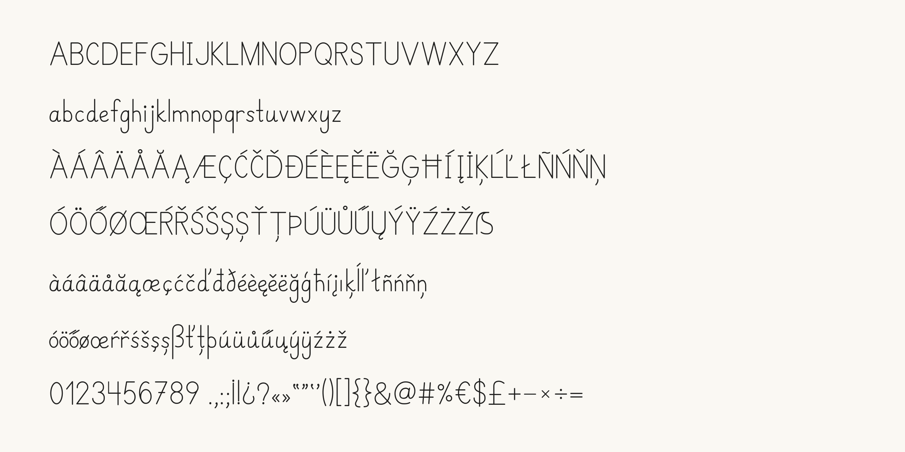
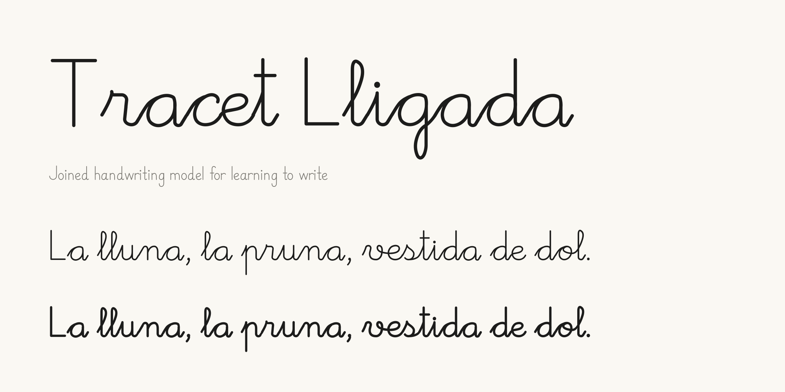
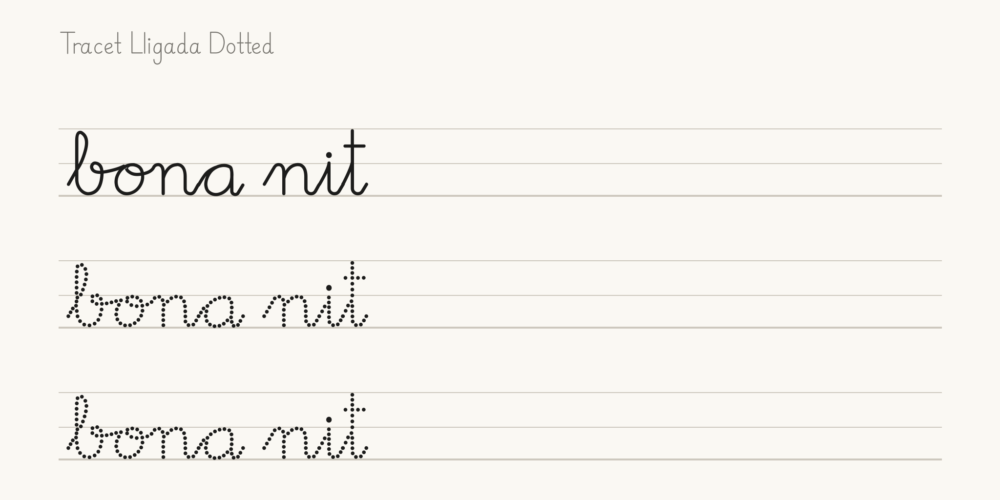
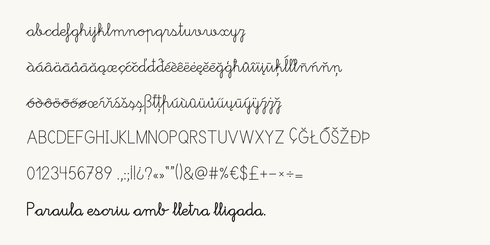

# Tracet










Tracet is a family of handwriting-model typefaces for learning to read and write, designed by David Martínez at [Paraula](https://paraula.com).

- **Tracet Pal**: an upright, print-script model ("lletra de pal") in four weights: Thin, Regular, Bold and ExtraBold.
- **Tracet Pal Dotted**: the same letters drawn as dotted lines, for tracing practice.
- **Tracet Lligada**: the joined (cursive) model ("lletra lligada") in Regular and Bold. Each letter connects to the next with OpenType rules, accented letters included.
- **Tracet Lligada Dotted**: the joined letters drawn as dotted lines.

The letters are built from a single stroke skeleton, the same line a child follows with a pencil. Each weight is the same skeleton with a different stroke width, and the dotted style places evenly spaced dots along it.

*Tracet* is Catalan for "trace, stroke".

## Character set

Google Fonts Latin Core (GF_Latin_Core), which covers the languages of Western, Central and Eastern Europe written in the Latin script.

## Building

The UFO files in `sources/` are the masters. To build the fonts:

```
pip install -r requirements.txt
cd sources
gftools builder config.yaml
gftools builder config-dotted.yaml
gftools builder config-lligada.yaml
gftools builder config-lligada-dotted.yaml
```

The fonts are written to `fonts/ttf/`.

### Helper scripts

`scripts/` contains the tools used to edit the UFO masters. They are not needed to build the fonts.

- `componer_acentos.py`: composes accented letters from the accents already drawn, adds the combining marks and the mark anchors.
- `trazos_svg.py`: imports the letters and accents drawn as centre-line strokes in `sources/dibujos/*.svg`. It strokes them at the width of each weight and dots them for the Dotted style.
- `calidad.py`: outline clean-up, kerning after ď ľ ť Ľ, and dotless i/j when a combining accent follows (`ccmp`). Run it after the two scripts above.
- `muestras.py`: renders the specimen images in `documentation/img/` and `documentation/lligada/img/`.
- `lligada_acentos.py`: completes the Lligada character set. New accented letters are decomposed into base letter + combining mark (`ccmp`), the joining rules ignore marks, and every joining glyph gets mark anchors over each letter it contains. Capitals and symbols come from Tracet Pal.
- `lligada_eth_thorn.py`: adds ð and þ, drawn from the Lligada's own d, h and p strokes, with the same joins as d and h.
- `puntos_componentes.py`: in the Dotted styles, turns every dot into a component of one `_dot` glyph, which keeps the files small.
- `lligada_calidad.py`: Lligada clean-up: outlines, equal widths for math signs, removal of glyphs no rule can reach, and short production names. Run the Lligada scripts in this order: `lligada_acentos.py`, `lligada_eth_thorn.py`, `puntos_componentes.py` (Dotted), `lligada_calidad.py`.
- `build.py`: a local build with fontmake that does not require gftools.

## License

This Font Software is licensed under the SIL Open Font License, Version 1.1. The license is in [OFL.txt](OFL.txt) and is also available with a FAQ at https://openfontlicense.org

## Authors

See [AUTHORS.txt](AUTHORS.txt).
